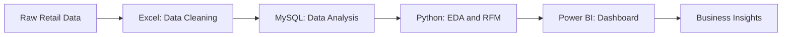
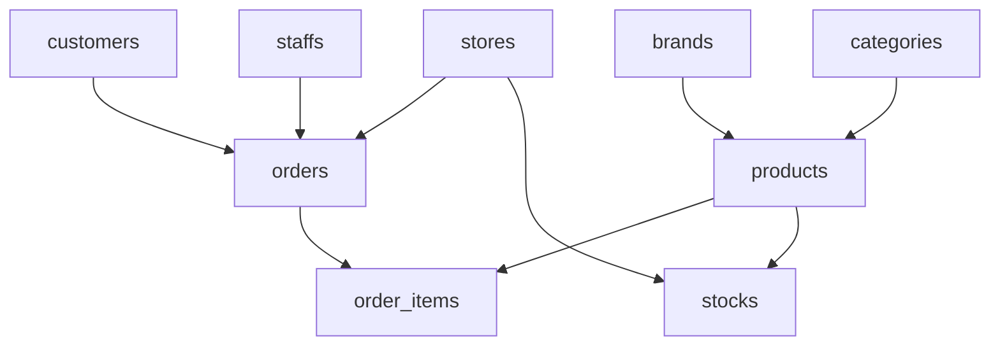

# 🛍️ Retail Sales Analytics

### End-to-End Data Analytics Project Using Excel, SQL, Python & Power BI

**Turning retail data into actionable business insights.**

<p align="center">
  
  
  
  
  
</p>

**Author:** HEMA PRASANTH S
**Academy:** Vinsup Skill Academy

---

## 📌 Table of Contents

1. [Project Overview](#-project-overview)
2. [Business Problem](#-business-problem)
3. [Project Objectives](#-project-objectives)
4. [Tools and Technologies](#-tools-and-technologies)
5. [Dataset Description](#-dataset-description)
6. [Project Workflow](#-project-workflow)
7. [Phase 1 — Excel](#-phase-1--excel-data-cleaning-and-analysis)
8. [Phase 2 — SQL](#-phase-2--sql-database-and-business-analysis)
9. [Phase 3 — Python](#-phase-3--python-eda-and-rfm-analysis)
10. [Phase 4 — Power BI](#-phase-4--power-bi-dashboard)
11. [Key Business Questions](#-key-business-questions)
12. [Project Screenshots](#-project-screenshots)
13. [Repository Structure](#-repository-structure)
14. [How to Run the Project](#-how-to-run-the-project)
15. [Results and Business Value](#-results-and-business-value)
16. [Limitations](#-limitations-and-notes)
17. [Useful Resources](#-useful-learning-resources)
18. [Author](#-author)

---

## 📊 Project Overview

Retail Sales Analytics is an end-to-end data analytics project designed to explore retail business performance using Microsoft Excel, MySQL, Python, and Power BI.

The project follows a structured workflow, starting with data preparation and continuing through SQL-based analysis, Python exploratory data analysis (EDA), customer segmentation, and interactive business reporting.

| Phase | Tool            | Main Activities                                                | Intended Output                 |
| ----- | --------------- | -------------------------------------------------------------- | ------------------------------- |
| 1     | Microsoft Excel | Data cleaning, validation, formulas, and PivotTables           | Prepared datasets and summaries |
| 2     | MySQL           | Database operations, joins, aggregations, and business queries | SQL analysis results            |
| 3     | Python          | Data exploration, calculations, and RFM analysis               | Customer analysis outputs       |
| 4     | Power BI        | KPI cards, charts, slicers, and report pages                   | Interactive analytics dashboard |

### Project Pipeline



## 🎯 Business Problem

Retail businesses collect data about customers, orders, products, stores, staff, and inventory. When this information is stored across multiple tables or inconsistent files, understanding overall business performance can be challenging.

This project uses data analytics techniques to investigate sales performance, customer purchasing behaviour, product performance, and inventory levels.

The goal is to transform raw retail data into structured information that can help business users make informed decisions.

## ✅ Project Objectives

* Clean and prepare retail datasets using Excel.
* Organize and analyse relational data using MySQL.
* Use SQL joins and aggregations to investigate business performance.
* Perform exploratory data analysis using Python.
* Calculate customer Recency, Frequency, and Monetary (RFM) metrics.
* Develop an interactive Power BI dashboard.
* Validate analysis results across tools.
* Communicate findings clearly to support business decision-making.

## 🧰 Tools and Technologies

| Tool / Technology | Purpose                                                        |
| ----------------- | -------------------------------------------------------------- |
| Microsoft Excel   | Data cleaning, formulas, lookups, and PivotTables              |
| MySQL             | Database management, joins, aggregations, and analysis queries |
| Python            | Data processing and exploratory analysis                       |
| pandas            | Data manipulation and analysis                                 |
| NumPy             | Numerical operations                                           |
| Matplotlib        | Data visualization                                             |
| Seaborn           | Statistical visualization                                      |
| SQLAlchemy        | Optional Python-to-database connectivity                       |
| Jupyter Notebook  | Optional interactive Python analysis                           |
| Power BI          | Interactive dashboards and business reporting                  |
| GitHub            | Project documentation and portfolio presentation               |

## 🗂️ Dataset Description

The project uses a relational retail/bicycle sales dataset organized into nine tables.

| Table         | Description                                               |
| ------------- | --------------------------------------------------------- |
| `customers`   | Customer information                                      |
| `orders`      | Order details, dates, and customer/store/staff references |
| `order_items` | Product quantities, prices, and order-line details        |
| `products`    | Product names and related details                         |
| `brands`      | Product brand information                                 |
| `categories`  | Product category information                              |
| `stocks`      | Inventory quantities by product and store                 |
| `stores`      | Store information                                         |
| `staffs`      | Staff information and store relationships                 |

### Database Relationships



**Data note:** Verify the original dataset schema before running queries. Actual column names, relationships, date ranges, and record counts should be documented using the source files. Do not publish sensitive customer information.

## 🔄 Project Workflow

1. Inspect the raw files and database schema.
2. Clean and validate data in Excel.
3. Import the datasets into MySQL.
4. Verify table structures and relationships.
5. Run SQL queries to answer business questions.
6. Use Python to inspect data quality and explore patterns.
7. Calculate RFM metrics if the required purchase-history fields are available.
8. Prepare the data for Power BI.
9. Build dashboard visuals and filters.
10. Validate the final measures against the source data.

---

## 🟩 Phase 1 — Excel: Data Cleaning and Analysis

### Data Cleaning Tasks

* Standardize column names and data formats.
* Identify missing values and duplicate records.
* Validate date, quantity, and price columns.
* Review negative quantities and unusual prices.
* Check ZIP codes and phone numbers for missing or invalid values.
* Use formulas and lookups where appropriate.
* Preserve the original data and work on a cleaned copy.

### Example Excel Formulas

| Task                    | Example Formula                                          | Purpose                                     |
| ----------------------- | -------------------------------------------------------- | ------------------------------------------- |
| Count blank cells       | `=COUNTBLANK(A2:A100)`                                   | Identify missing values                     |
| Flag repeated IDs       | `=COUNTIF($A:$A,A2)>1`                                   | Identify records for duplicate review       |
| Calculate line sales    | `=[@quantity]*[@list_price]`                             | Calculate quantity multiplied by unit price |
| Retrieve a product name | `=IFERROR(VLOOKUP(A2,Products!A:B,2,FALSE),"Not found")` | Find a product name using its ID            |

These are example formulas. Adjust the ranges and column names to match the workbook.

**Important:** Repeated order IDs do not automatically indicate duplicate records. An order may contain multiple valid product lines. Check the appropriate record key before removing data.

### Excel Analysis

* Summarize sales by product and category.
* Compare sales across available dates.
* Rank products using a consistent sales measure.
* Use PivotTables to summarize the cleaned data.
* Investigate unusual values before deciding how to handle them.

### Excel Screenshots

#### Data cleaning and validation


#### Brand and category data


#### Additional Excel checks


---

## 🟦 Phase 2 — SQL: Database and Business Analysis

### Database Setup

The project database used in the working SQL examples is `retail_db`.

```sql
USE retail_db;
```

The working project uses cleaned table names such as:

* `customers_cleaned`
* `orders_cleaned`
* `order_items_cleaned`
* `products_cleaned`
* `brands_cleaned`
* `categories_cleaned`
* `stocks_cleaned`
* `stores_cleaned`
* `staffs_cleaned`

Confirm that these tables exist in your database before running the queries.

### Example 1: Gross Line Sales by Product

```sql
SELECT
    p.product_id,
    p.product_name,
    ROUND(
        SUM(oi.quantity * oi.list_price),
        2
    ) AS gross_line_sales
FROM products_cleaned AS p
JOIN order_items_cleaned AS oi
    ON p.product_id = oi.product_id
GROUP BY
    p.product_id,
    p.product_name
ORDER BY gross_line_sales DESC;
```

**Explanation:** This query calculates quantity multiplied by list price for each order line, aggregates the values by product, and sorts the products from highest to lowest gross line sales.

This example excludes discounts, returns, cancellations, and taxes.

### Example 2: Top Five Products by Quantity Sold

```sql
SELECT
    p.product_id,
    p.product_name,
    SUM(oi.quantity) AS total_quantity_sold
FROM products_cleaned AS p
JOIN order_items_cleaned AS oi
    ON p.product_id = oi.product_id
GROUP BY
    p.product_id,
    p.product_name
ORDER BY total_quantity_sold DESC
LIMIT 5;
```

**Explanation:** Identifies the five products with the highest total recorded quantity.

### Example 3: Products with Low Stock

```sql
SELECT
    product_id,
    store_id,
    quantity
FROM stocks_cleaned
WHERE quantity < 10
ORDER BY quantity ASC;
```

**Explanation:** Identifies product/store inventory records below 10 units. The threshold is an example and should be adjusted to the business requirement.

### Example 4: Revenue by Staff Member

```sql
SELECT
    s.staff_id,
    s.first_name,
    s.last_name,
    ROUND(
        SUM(oi.quantity * oi.list_price),
        2
    ) AS gross_line_sales
FROM staffs_cleaned AS s
JOIN orders_cleaned AS o
    ON s.staff_id = o.staff_id
JOIN order_items_cleaned AS oi
    ON o.order_id = oi.order_id
GROUP BY
    s.staff_id,
    s.first_name,
    s.last_name
ORDER BY gross_line_sales DESC;
```

**Explanation:** Aggregates gross line sales for orders associated with each staff member.

This query assumes the cleaned staff table includes `first_name` and `last_name`. If those columns are not available, remove them from the `SELECT` and `GROUP BY` clauses.

### SQL Analysis Checklist

| Analysis                    | SQL Techniques                 | Purpose                           |
| --------------------------- | ------------------------------ | --------------------------------- |
| Product performance         | `JOIN`, `SUM()`, `GROUP BY`    | Compare sales by product          |
| Monthly sales               | Date functions and aggregation | Identify sales patterns over time |
| Customer spending           | `SUM()` and `GROUP BY`         | Understand customer value         |
| Store performance           | Joins and aggregation          | Compare store results             |
| Staff performance           | Joins and aggregation          | Summarize sales by staff          |
| Inventory checks            | `WHERE` filters                | Identify low-stock records        |
| Customer segmentation input | Customer-level aggregation     | Prepare data for RFM analysis     |

### SQL Screenshots


---

## 🐍 Phase 3 — Python: EDA and RFM Analysis

### Python Activities

* Load data from CSV files or a configured SQL connection.
* Inspect the number of rows and columns.
* Review missing values, duplicates, and data types.
* Calculate sales measures from available order-line fields.
* Explore product and customer purchasing patterns.
* Calculate RFM metrics when the required data is available.
* Export analysis outputs for further reporting.

### Install Required Packages

```bash
pip install pandas numpy matplotlib seaborn sqlalchemy
```

Install an appropriate database driver separately if Python will connect directly to MySQL.

### Example 1: Load and Inspect Data

```python
import pandas as pd

# Update the path to match your project files.
orders = pd.read_csv("data/orders.csv")

print("Dataset shape:", orders.shape)
print(orders.head())
print(orders.info())
print("Missing values:")
print(orders.isna().sum())
print("Duplicate rows:", orders.duplicated().sum())
```

### Example 2: Calculate Gross Line Sales

```python
import pandas as pd

items = pd.read_csv("data/order_items.csv")

items["quantity"] = pd.to_numeric(
    items["quantity"],
    errors="coerce"
)

items["list_price"] = pd.to_numeric(
    items["list_price"],
    errors="coerce"
)

items["line_sales"] = (
    items["quantity"] * items["list_price"]
)

print(items[["quantity", "list_price", "line_sales"]].head())
print("Gross line sales:", items["line_sales"].sum())
```

These examples assume the specified files and columns exist. Update the file paths and field names to match the actual dataset.

### RFM Customer Analysis

RFM stands for Recency, Frequency, and Monetary value.

| Metric    | Definition                        | Typical Calculation                    |
| --------- | --------------------------------- | -------------------------------------- |
| Recency   | How recently a customer purchased | Reference date minus latest order date |
| Frequency | How often a customer ordered      | Number of distinct orders              |
| Monetary  | How much a customer spent         | Sum of the selected sales measure      |

### RFM Workflow

1. Select the analysis period and reference date.
2. Calculate each customer's latest order date.
3. Calculate recency in days.
4. Count distinct orders for frequency.
5. Calculate monetary value using the agreed sales definition.
6. Apply documented scoring rules.
7. Assign customer segments.
8. Review segment counts and export the results.

Lower recency generally indicates a more recent purchase. Higher frequency and monetary value generally indicate more frequent purchasing and higher spending.

**Note:** RFM segment labels and scoring thresholds should be based on the actual analysis. This README does not claim specific segment counts or customer results.

### Python Screenshots


---

## 📈 Phase 4 — Power BI Dashboard

### Dashboard Objectives

The planned dashboard is intended to present retail performance through KPI cards, charts, tables, and interactive filters.

| Dashboard Section  | Suggested Visuals                     | Business Question                         |
| ------------------ | ------------------------------------- | ----------------------------------------- |
| Overview           | KPI cards and sales trends            | What is the overall performance?          |
| Sales Analysis     | Monthly sales and order trends        | How does performance change over time?    |
| Product Analysis   | Product ranking and category charts   | Which products perform well?              |
| Customer Analysis  | Customer metrics and RFM segments     | How do customers purchase?                |
| Inventory Analysis | Stock summaries and low-stock records | Which products may require replenishment? |

Include only the pages and visuals available in the final Power BI report.

### Example KPI Definitions

| KPI                 | Definition                                                  |
| ------------------- | ----------------------------------------------------------- |
| Total Sales         | Sum of the agreed sales measure                             |
| Total Orders        | Count of distinct order IDs                                 |
| Total Customers     | Count of distinct customer IDs in the selected context      |
| Average Order Value | Total sales divided by total orders                         |
| Low-Stock Records   | Count of product/store records below the selected threshold |

### Dashboard Development Checklist

* Import the required tables.
* Set appropriate data types.
* Create and validate table relationships.
* Define explicit measures for key performance indicators.
* Add charts, slicers, titles, and tooltips.
* Test filtering and cross-highlighting.
* Compare key totals with SQL results.
* Use a consistent charcoal/black and orange theme with readable labels.

### Power BI Screenshots

#### Dashboard Overview


#### Sales Analysis


#### Product Analysis


#### Customer Analysis


---

## ❓ Key Business Questions

| No. | Business Question                                                   | Tool                 |
| --: | ------------------------------------------------------------------- | -------------------- |
|   1 | Are there missing values, duplicate records, or invalid data types? | Excel, Python        |
|   2 | Which products generate the highest gross line sales?               | SQL, Power BI        |
|   3 | How do sales change over time?                                      | Excel, SQL, Power BI |
|   4 | Which categories contribute most to sales?                          | Excel, SQL, Power BI |
|   5 | Which customers order frequently or spend more?                     | SQL, Python          |
|   6 | Which product/store records fall below the stock threshold?         | SQL, Power BI        |
|   7 | Can customers be segmented using RFM metrics?                       | Python               |
|   8 | Can business users explore performance by date, product, or store?  | Power BI             |

---

## 🖼️ Project Screenshots

The screenshots above provide visual documentation of the project workflow. For future updates, keep images organized in the following structure.

```text
images/
├── excel/
│   ├── excel-cleaning.png
│   ├── excel-pivottable.png
│   └── excel-formula.png
├── sql/
│   ├── sql-schema.png
│   ├── sql-sales-query.png
│   └── sql-low-stock.png
├── python/
│   ├── python-data-inspection.png
│   ├── python-eda.png
│   └── python-rfm-segments.png
└── powerbi/
    ├── dashboard-overview.png
    ├── dashboard-sales.png
    ├── dashboard-products.png
    └── dashboard-customers.png
```

These are suggested filenames. Use the actual file paths in the README when adding images stored in your repository.

---

## 📁 Repository Structure

A suggested GitHub repository structure is shown below. Keep only files that exist in the actual project.

```text
retail-sales-analytics/
├── README.md
├── data/
│   └── README.md
├── excel/
│   ├── retail-sales-analysis.xlsx
│   └── README.md
├── sql/
│   ├── schema.sql
│   ├── sales_analysis.sql
│   ├── customer_analysis.sql
│   └── inventory_analysis.sql
├── python/
│   ├── retail_sales_eda.ipynb
│   ├── customer_rfm_analysis.ipynb
│   └── requirements.txt
├── powerbi/
│   └── retail_sales_dashboard.pbix
└── images/
    ├── excel/
    ├── sql/
    ├── python/
    └── powerbi/
```

---

## 🚀 How to Run the Project

### 1. Get the Repository

Clone your repository after replacing the placeholder URL with your actual GitHub repository.

```bash
git clone https://github.com/YOUR-USERNAME/retail-sales-analytics.git
cd retail-sales-analytics
```

### 2. Prepare the Data

* Review the source dataset and its usage permissions.
* Open the Excel workbook and review the cleaning steps.
* Preserve the raw data separately from the cleaned files.

### 3. Run SQL Analysis

* Open MySQL Workbench.
* Select the `retail_db` database.
* Confirm that the cleaned tables and columns exist.
* Run the relevant SQL queries.
* Validate the returned results.

### 4. Run Python Analysis

Install the required packages:

```bash
pip install pandas numpy matplotlib seaborn sqlalchemy
```

Run the notebook or script after updating the file paths and database configuration.

### 5. Open the Power BI Dashboard

* Open the `.pbix` file if available.
* Update data-source paths when necessary.
* Refresh the data model.
* Check relationships, filters, and KPI calculations.

### 6. Validate the Results

Compare key sales totals and order counts between SQL, Python, and Power BI. Investigate discrepancies before reporting final findings.

### Optional Git Commands

```bash
git add README.md
git commit -m "Improve Retail Sales Analytics README"
git push
```

Run these commands from your existing repository after reviewing the changes.

---

## 💡 Results and Business Value

The project is designed to produce the following outputs:

* Consistent and analysis-ready retail data.
* Reusable SQL queries for business analysis.
* Python-based data quality checks and exploratory analysis.
* RFM metrics for understanding customer purchasing behaviour.
* Interactive Power BI reporting.
* A documented workflow connecting data preparation to business reporting.

### Verified Findings

Add actual results after completing and validating the relevant analyses.

| Metric                  | Result                                     |
| ----------------------- | ------------------------------------------ |
| Total sales             | To be calculated and verified              |
| Distinct orders         | To be calculated and verified              |
| Top-performing product  | To be identified from query results        |
| Top-performing category | To be identified from query results        |
| Highest-sales month     | To be identified from date analysis        |
| RFM segment counts      | To be calculated from customer analysis    |
| Low-stock records       | To be counted using the selected threshold |

These are pending result fields, not measured outcomes. Replace them with actual results or remove the table until validation is complete.

---

## ⚠️ Limitations and Notes

* SQL examples assume the cleaned table names and columns shown in the code. Confirm them against the actual database schema.
* Gross line sales are not necessarily equivalent to net revenue.
* Discounts, returns, cancellations, taxes, and other adjustments must follow the selected business definition.
* Duplicate checks must use the appropriate record key.
* RFM outputs depend on the reference date, analysis period, scoring rules, and available order history.
* Dashboard results depend on data relationships, filters, and measure definitions.
* Screenshots document the workflow but do not independently establish numeric results.
* Do not upload credentials, private customer details, or data you are not authorized to share.

---

## 🔗 Useful Learning Resources

| Topic                   | Resource                                                                                                              |
| ----------------------- | --------------------------------------------------------------------------------------------------------------------- |
| Excel                   | [Microsoft Excel Help](https://support.microsoft.com/excel)                                                           |
| Excel XLOOKUP           | [Microsoft XLOOKUP Guide](https://support.microsoft.com/office/xlookup-function-b7fd680e-6d10-43e6-84f9-88eae8bf5929) |
| MySQL                   | [MySQL Documentation](https://dev.mysql.com/doc/)                                                                     |
| SQL Joins               | [MySQL JOIN Documentation](https://dev.mysql.com/doc/refman/8.4/en/join.html)                                         |
| Python                  | [Python Documentation](https://docs.python.org/3/)                                                                    |
| pandas                  | [pandas Documentation](https://pandas.pydata.org/docs/)                                                               |
| SQLAlchemy              | [SQLAlchemy Documentation](https://docs.sqlalchemy.org/)                                                              |
| Power BI                | [Microsoft Learn — Power BI](https://learn.microsoft.com/power-bi/)                                                   |
| Power BI Data Modelling | [Microsoft Learn — Data Modelling](https://learn.microsoft.com/power-bi/transform-model/)                             |
| GitHub                  | [GitHub Documentation](https://docs.github.com/)                                                                      |
| Markdown                | [GitHub Markdown Guide](https://docs.github.com/en/get-started/writing-on-github)                                     |

---

## 👨‍💻 Author

**HEMA PRASANTH S**

Retail Sales Analytics Project
Vinsup Skill Academy

This project demonstrates an end-to-end approach to retail data preparation, SQL analysis, Python-based exploration, and business intelligence reporting.

---

<p align="center">
  <strong>Excel → SQL → Python → Power BI</strong>
  <br>
  <em>Clean the data. Analyse the business. Understand customers. Communicate insights.</em>
</p>
